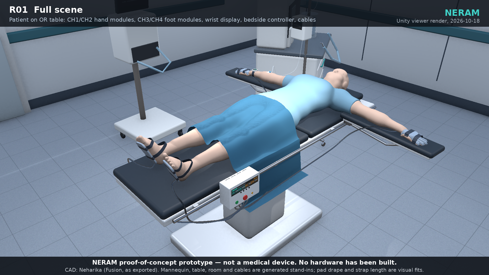
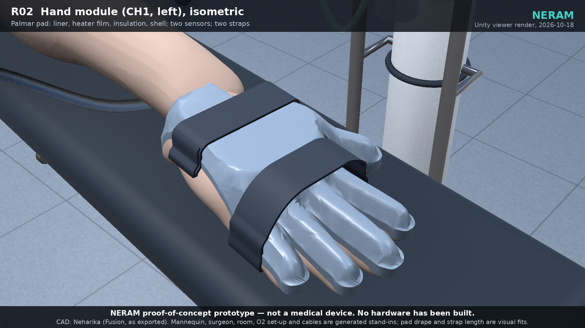
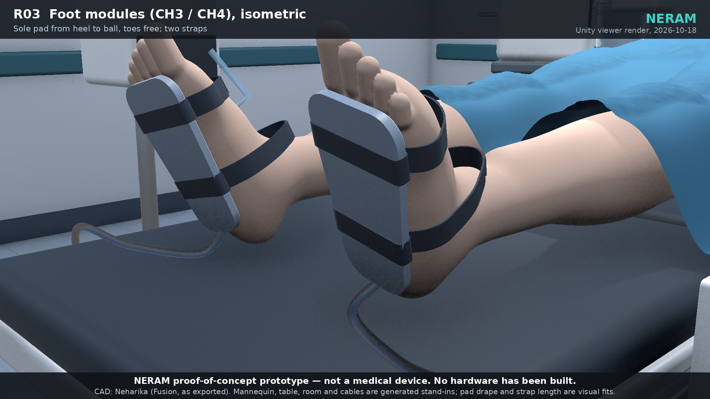
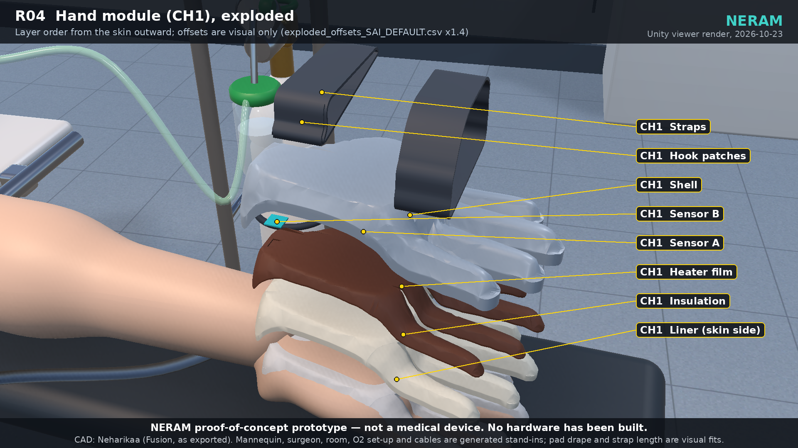
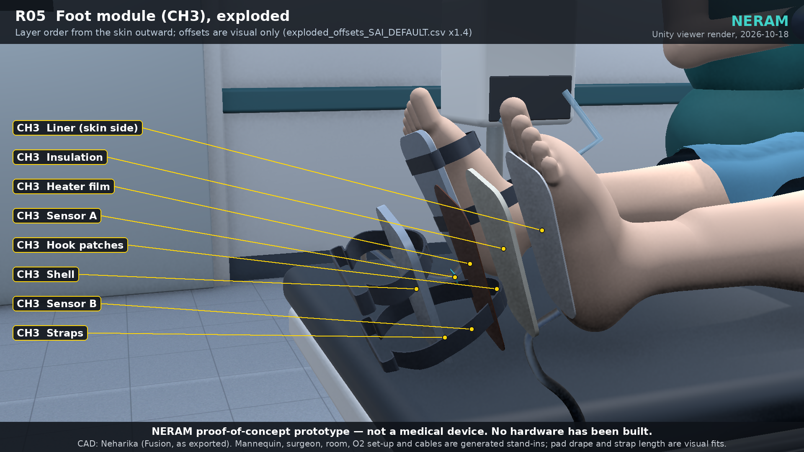
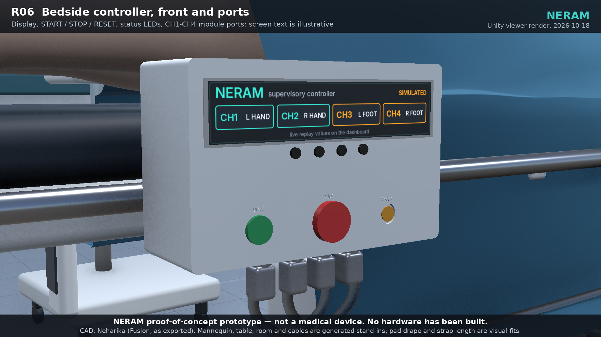
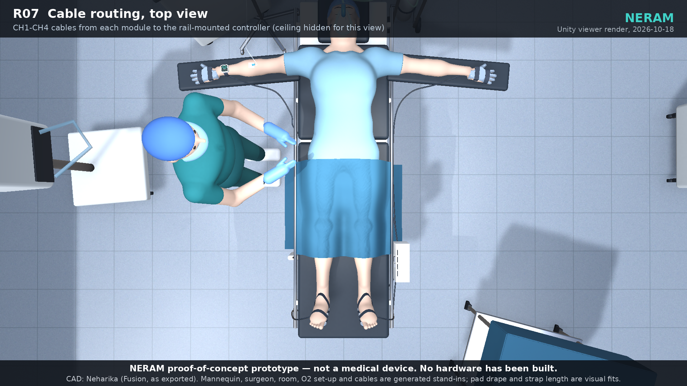
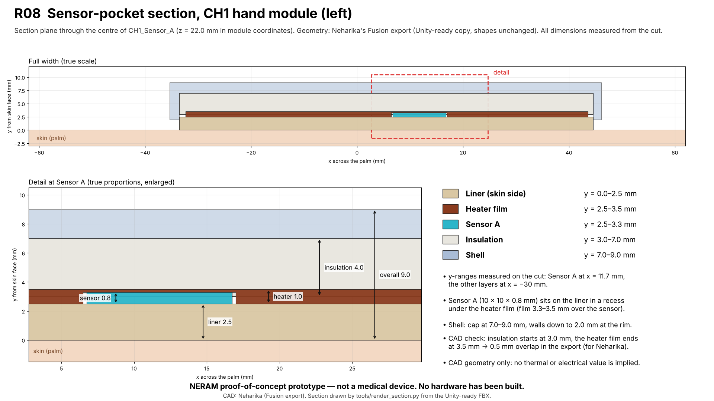

# CAD (owner: Neharikaa)

README written by Sai on 18 Oct 2026 for Neharikaa's CAD.
Proof-of-concept prototype, not a medical device. The CAD shows a paper design; nothing has been manufactured.

## Renders

Neharikaa's CAD in the NERAM viewer (details in [`renders/README.md`](renders/README.md)). Mannequin, room and cables are
generated stand-ins.

| Hand module (CH1) | Foot modules (CH3 / CH4) |
|---|---|
|  |  |
| **Hand module, exploded layers** | **Foot module, exploded layers** |
|  |  |
| **Bedside controller** | **Cable routing (top view)** |
|  |  |

**Sensor-pocket section** (measured from the CH1 FBX)

## What is here
| Folder | Contents |
|---|---|
| `exports/source_fusion_2026-10-18/` | Neharikaa's four FBX files exactly as exported from Autodesk Fusion (hand modules CH1+CH2, foot modules CH3+CH4, bedside controller, wearable display concept) |
| `exports/unity/` | Unity-ready copies made by `tools/fixneha.py`: metres, Y up, plan object names, `MAT_*` materials; shapes unchanged. `PREP_REPORT_2026-10-18.json` lists every change; `exploded_offsets_SAI_DEFAULT.csv` is a visual default |
| `renders/` | Plan renders R01–R08 (see `renders/README.md`) and earlier viewer pictures |
| `tools/` | `fixneha.py` (the Unity prep step) with its helpers `fbxio.py`, `fbxinspect.py`, `qem.py` (decimation) |
| `IMPORT_CHECK_SAI_2026-10-18.md` | Unity import check and what the prep step changed |

## How to open the files
- FBX files are stored with Git LFS: install Git LFS before cloning (`git lfs install`), or download them from the GitHub file page.
- **Autodesk Fusion:** File → Open → Open from my computer → choose the `.fbx`.
- **Blender (free):** File → Import → FBX. The `exports/unity/` copies import at real size in metres.
- **Unity:** the viewer project `unity_editor/` already contains the Unity copies; menu **NERAM > CAD > Place Neharika CAD on the mannequin**.
- PNG renders open in any image viewer.

## Scope
Neharikaa's part is the 3D models, delivered on 18 Oct and complete. STEP/native files, 2D drawings, strain-relief parts and an assembly file are not part of this submission.

Licence: CC BY 4.0 (`LICENSE-CAD-DOCS`).
