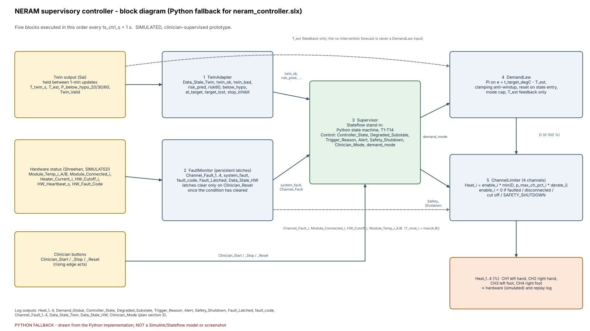
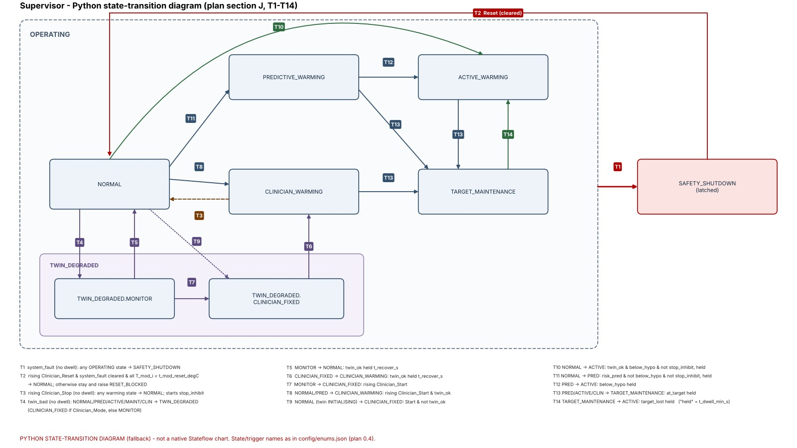
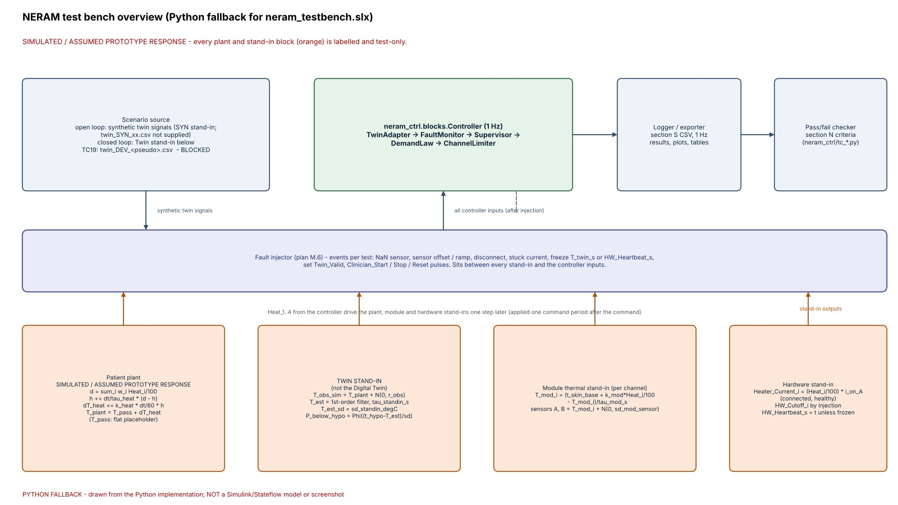
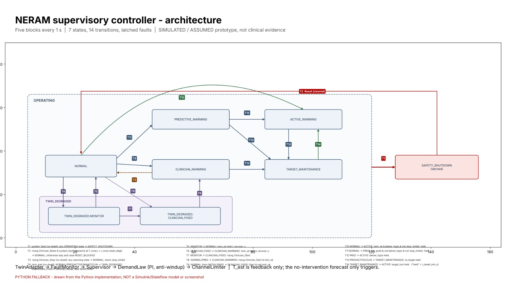
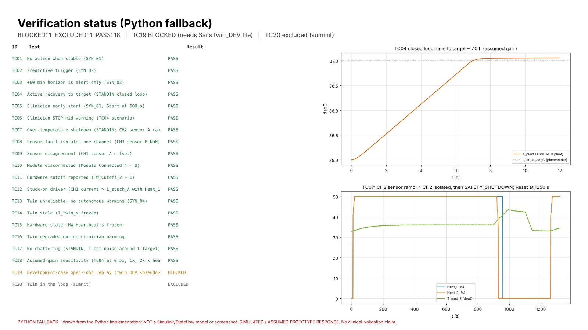

# NERAM supervisory controller - Python fallback

Owner: Suchitha (supervisory controller, plan pp. 4-23). **SIMULATED / ASSUMED prototype. No clinical efficacy or clinical validation is claimed.**

MATLAB/Simulink/Stateflow were not available, so the controller, test bench, tests, logs, plots and tables are implemented and
run in Python. This is a *fallback*: the native `.slx`/Stateflow deliverables are **not** produced (list at the end).

## Environment actually used

| item | version |
|---|---|
| Python | 3.13.16 |
| numpy | 2.5.3 |
| pandas | 3.0.5 |
| matplotlib | 3.11.2 |
| Pillow | 12.3.0 |
| imageio-ffmpeg (bundled ffmpeg 7.0.2, only for `demo_controller.mp4`) | 0.6.0 |

Linux, no GPU. Install: `pip install numpy pandas matplotlib pillow imageio-ffmpeg`.

## Run everything (one command, ~4 min)

```
cd controller
python scripts/run_all_tests.py             # TC01-TC19 (+TC20 listed as EXCLUDED), audit, logs, tables, plots, figures, slides, video
python scripts/run_all_tests.py --no-figs   # tests/logs/tables/plots only (~1 min)
python scripts/check_interface.py           # re-validates the six handoff logs against section S
```

The run is deterministic (fixed seed 42). It prints every PROVISIONAL / ASSUMED / placeholder parameter used.

## Where things are

| path | content |
|---|---|
| `neram_ctrl/` | `params.py`, `blocks.py` (TwinAdapter, FaultMonitor, Supervisor, DemandLaw, channel limiter), `testbench.py` (test-only stand-ins + fault injection), `tc_*.py` (test cases), `tc19.py`, `audit.py`, `logio.py`, `tables.py`, `plots.py`, `figures.py` |
| `scripts/run_all_tests.py` | orchestrator |
| `../integration/controller_logs/` | the six handoff logs `ctrl_SYN_02, ctrl_TC04, ctrl_TC05, ctrl_TC07, ctrl_TC08, ctrl_TC13` (copies in `results/logs/`) |
| `results/test_results.csv` | unified results table (one row per acceptance criterion) |
| `results/tables/` | T01 `T01_io.csv`, T02 `T02_params_used.csv`, `transition_table.csv`, `test_results.csv`, `fault_response_matrix.csv`, `requirements_traceability.csv`, T07 `T07_duty_stats.csv`, `audit_checks.csv` (section-G audit) |
| `results/plots/` | P01-P09 as `TCxx_P0n.png` (1600x900), applicability per the plan's table |
| `results/logs/` | per-test 1 Hz controller logs (handoff names + one per remaining TC) |
| `results/run_console.txt` | console output of the last run |
| `docs/controller_spec.md` | architecture, states, transitions, faults, parameters, assumptions, limitations |
| `docs/figures/` | `controller_block_diagram.png`, `stateflow_chart.png`, `testbench_overview.png`, `screenshots/S01..S07*_PYTHON_FALLBACK.png` |
| `docs/slide_controller_1.png`, `slide_controller_2.png`, `demo_controller.mp4` | slides / ~2.3 min video from the real run data |
| `tests/test_cases.csv` | generated from the implemented criteria (the team's `test_cases.csv` was not supplied) |
| `config_standalone/params_standalone.json` | standalone placeholder table (see below) |

## Inputs that were NOT supplied (dependencies)

- `config/params.json` (Sai) -> the controller uses the standalone table in `neram_ctrl/params.py` (values carried unchanged from the submitted script, every one labelled). **If `config/params.json` exists (or `NERAM_PARAMS` points to one) it is used automatically and the standalone table is only a fallback.** Nothing was changed in Sai's or Shreehan's values.
- `interface_spec.csv`, `fault_codes.csv`, `twin_SYN_xx.csv` -> section-S columns/enums and the section-3W fault-code list were taken from the plan text; synthetic twin signals are generated in `testbench.py`.
- `twin_DEV_<pseudo>.csv` (Sai) -> **TC19 is BLOCKED**. The integration path is ready in `neram_ctrl/tc19.py` (drop the file into `integration/twin_outputs/` or set `NERAM_TWIN_DEV`).
- Shreehan: module sensor valid range and `t_hw_cutoff_degC` -> range check (codes x02/x04) is implemented but disabled until supplied; no value invented.
- Sai: `plant_passive.*` -> flat passive trajectory placeholder; plant gain is `ASSUMED`.

## Native deliverables NOT produced (need MATLAB/Simulink/Stateflow)

`neram_controller.slx`, `neram_testbench.slx`, the MATLAB `.m` scripts and enum classes, a native Stateflow chart, native S01-S06 screenshots, the Simulation Data Inspector view, and a native `run_all_tests.m`. The `*_PYTHON_FALLBACK.png` images are drawn by code from the Python run and are labelled as such; none is a Simulink/Stateflow/SDI screenshot.

## Figures

All figures are drawn from the Python fallback run (labelled `PYTHON_FALLBACK`; none is a Simulink/Stateflow screenshot).
SIMULATED / ASSUMED prototype responses.

| Controller architecture | State chart (7 states, 14 transitions) |
|---|---|
|  |  |
| **Test bench (hardware stand-ins)** | **Architecture slide** |
|  |  |



Demo video of the real run data: [`docs/demo_controller.mp4`](docs/demo_controller.mp4).

