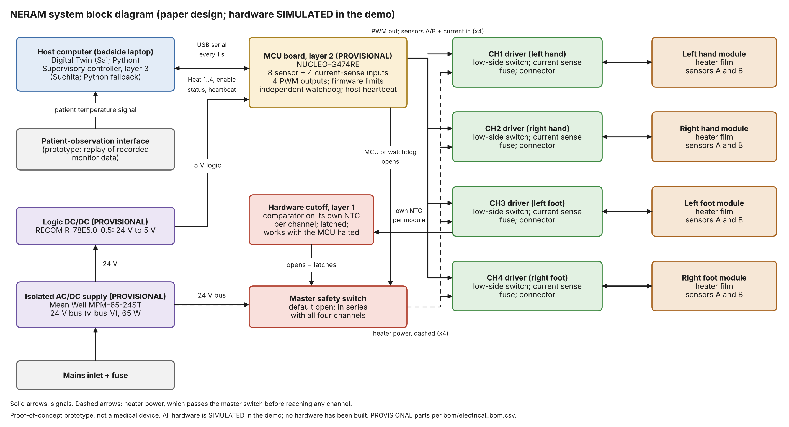
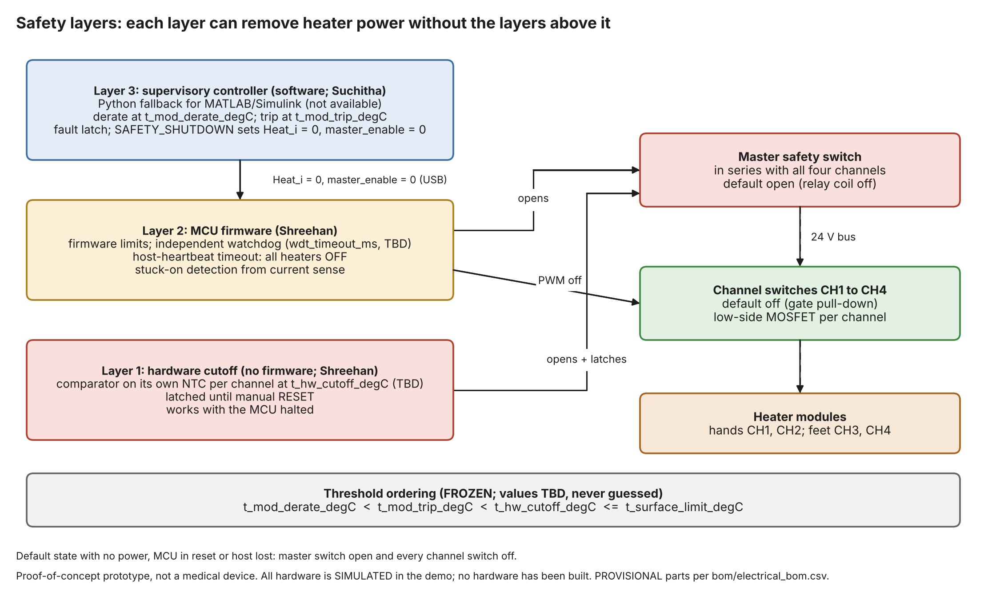
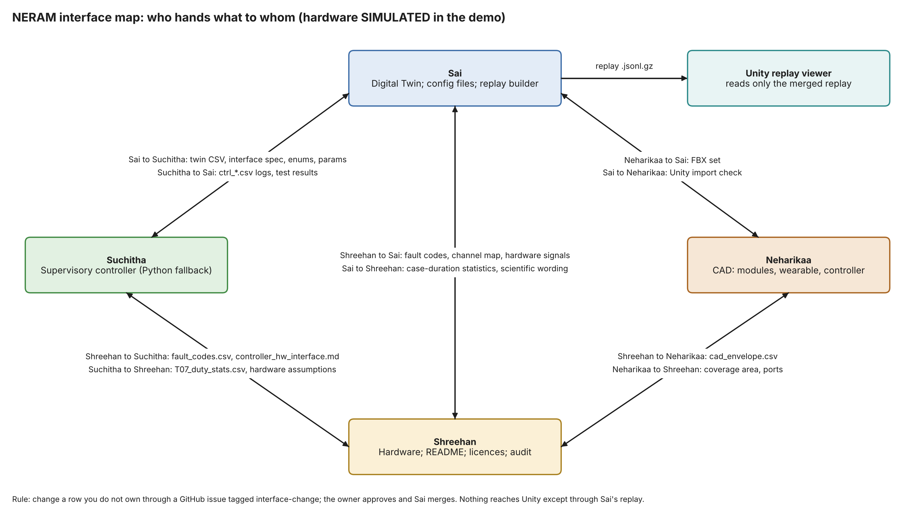
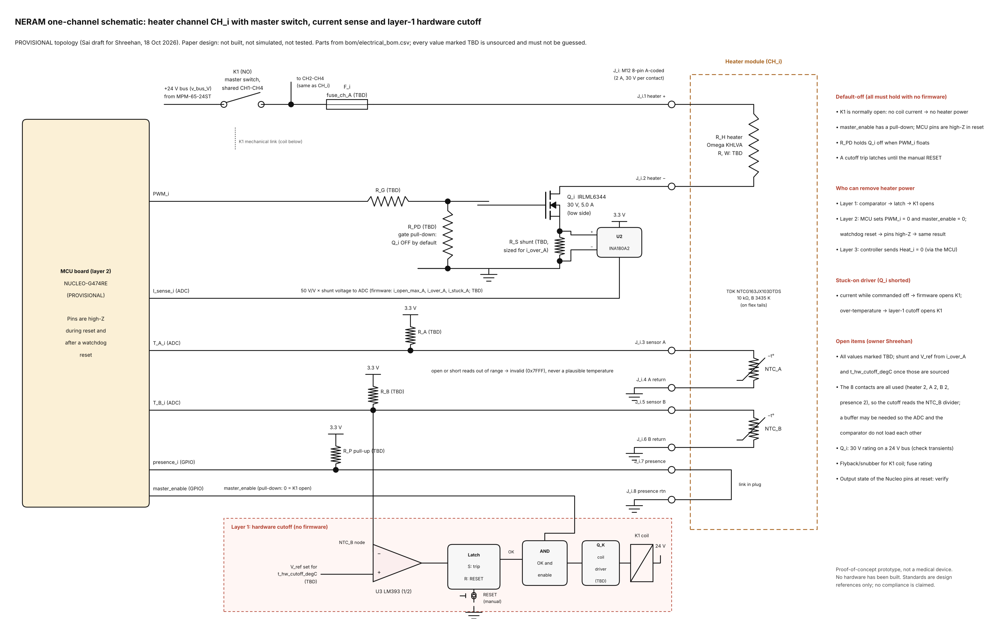

# Hardware (Shreehan)

Proof-of-concept prototype, not a medical device. All hardware in the demo is SIMULATED. Standards are design references only; no compliance is claimed. Every value has a source and a status (FROZEN, PROVISIONAL or TBD); unsourced values are TBD.

## Contents
| Folder or file | What it holds |
|---|---|
| diagrams/ | system_block_diagram, safety_layers, interface_map (.drawio source, .png and .pdf; all written by make_diagrams.py) |
| comparisons/ | sensor_comparison.csv, mcu_comparison.csv, heater_comparison.csv |
| docs/ | patient_observation_interface.md, module_sensing.md, power_architecture.md, standards_references.md, feasibility.md |
| interfaces/ | fault_codes.csv, comm_protocol.md, controller_hw_interface.md, cad_envelope.csv |
| power/ | power_budget.csv (reviewed copy) and power_budget.xlsx (same table as a workbook) |
| bom/ | electrical_bom.csv |
| schematics/ | channel_driver.kicad_sch: KiCad 8 conceptual schematic of one channel (make_kicad_schematic.py; netlist in channel_driver_netlist.csv); channel_driver.png / .pdf: the same circuit drawn by make_schematic.py |

## Diagrams and schematic

Paper design; all hardware is SIMULATED in the demo and nothing has been built. Images are written by
`diagrams/make_diagrams.py` and `schematics/make_schematic.py` (the `.drawio` sources open at app.diagrams.net).

| Safety layers | Interface map |
|---|---|
|  |  |

**One-channel schematic** (CH_i; PROVISIONAL topology, values TBD) — [KiCad 8 source](schematics/channel_driver.kicad_sch) · [PDF](schematics/channel_driver.pdf). The KiCad file embeds its symbols (library "NERAM"), so it opens in KiCad 8 without extra libraries; nets are joined by labels; File > Plot > PDF regenerates a KiCad-drawn PDF. It has not been opened in KiCad by the team yet (written by script on 19 Oct; Shreehan to review).

## Provisional choices (CP3)
- Heater: polyimide flexible heater, Omega KHLVA series (28 V). Not self-limiting, so the layer-1 cutoff is essential.
- MCU: STM32 Nucleo-G474RE. Reset state of outputs must still be verified.
- Sensor: TDK NTCG163JX103DTDS 10 kOhm NTC (0603) on a flex tail, 2 per module (PROVISIONAL; four types compared, docs/module_sensing.md).
- Supply: Mean Well MPM-65-24ST (24 V, 65 W); bus v_bus_V = 24 V (PROVISIONAL).

## Three safety layers
1. Hardware cutoff (no firmware).
2. MCU firmware (limits, independent watchdog, host heartbeat, stuck-on detection).
3. Supervisory controller (Suchitha).
Each layer can remove heater power without the layers above it.

## How to open the files
- .drawio: open at app.diagrams.net (File, Open from, Device). To regenerate source and images: `python hardware/diagrams/make_diagrams.py` `python hardware/schematics/make_schematic.py` (matplotlib) and `python hardware/schematics/make_kicad_schematic.py` (KiCad file).
- .csv: any spreadsheet app.
- .md: any text editor or GitHub.
