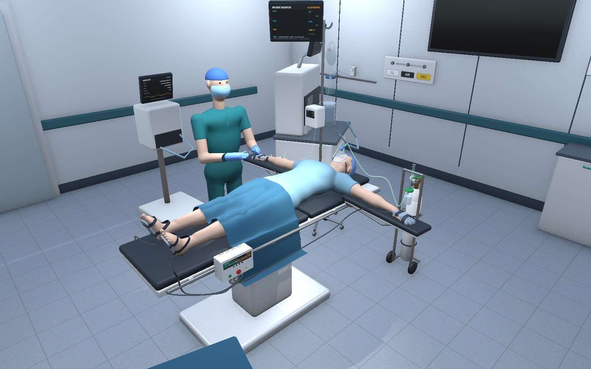
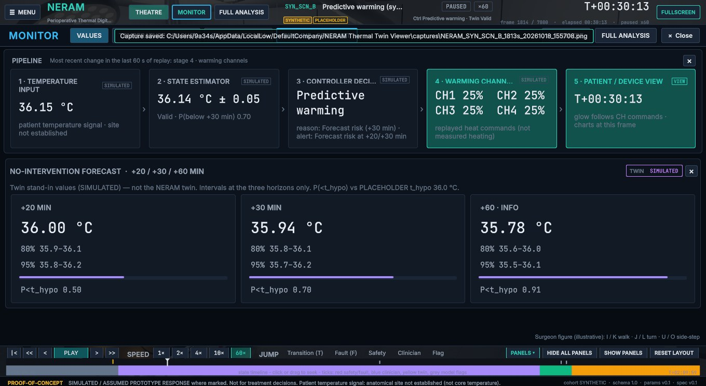
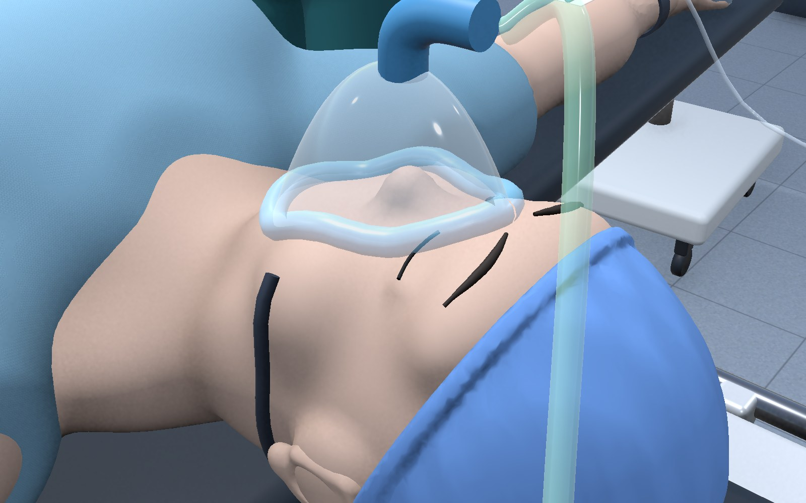
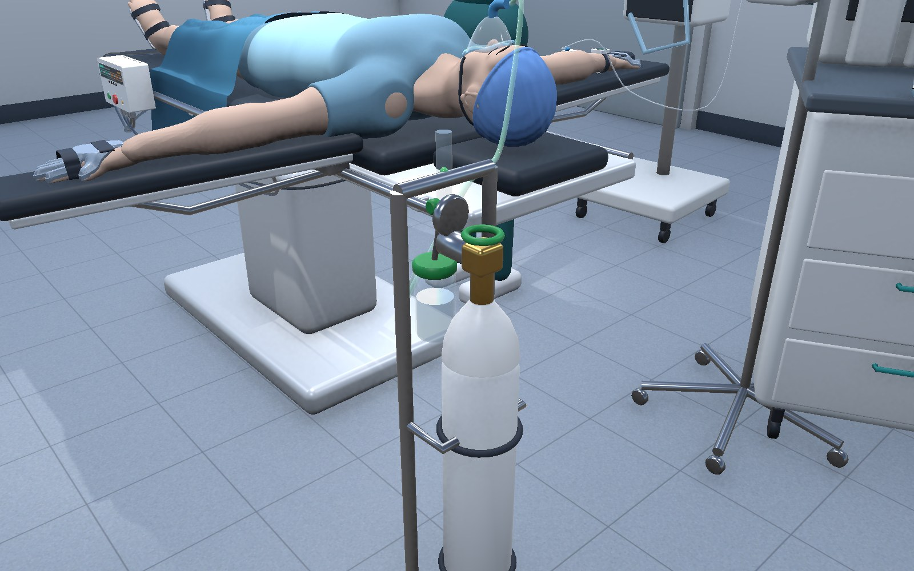
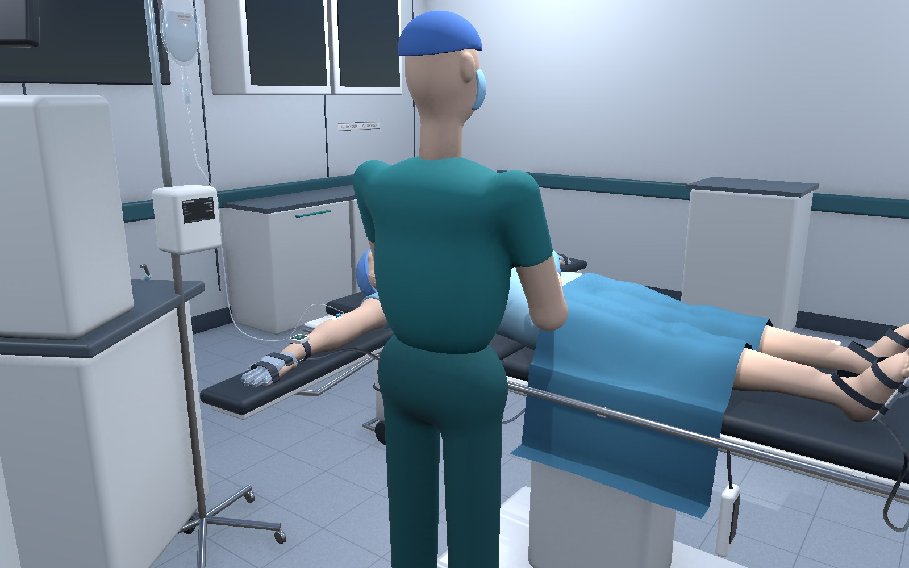
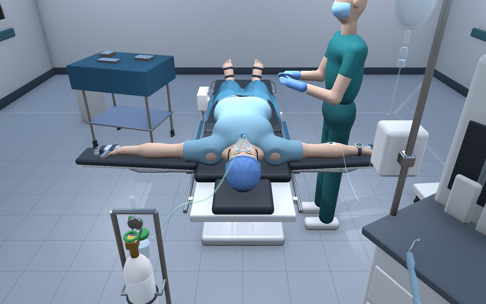

# NERAM: Unity visualisation layer (schema + notes)

This folder holds the replay **schema** (`schema/replay_fields.json`, generated `replay_schema.json`) shared by the
Python tools and the Unity project.

**The Unity project itself is `../unity_editor/`.** Open that folder in Unity Hub with **6000.3.26f1** (Workspace v3). Setup, controls, view modes,
chart meanings, value provenance and limitations are in **`../docs/UNITY_WORKSPACE_README.md`** and the user guide `../docs/NERAM_Viewer_User_Guide.pdf`.

* **What it is:** a replay viewer.
* **What it is not:** the thermal model, the controller, or a physiological simulator. No twin, controller-state transition or physiology is computed in C#.
* **Warming effects:** every warming effect shown is a **SIMULATED / ASSUMED PROTOTYPE RESPONSE**, because VitalDB contains no warming-response data.
* **Patient temperature signal:** its anatomical measurement site has not been established, so it is never labelled core temperature.
* **Holdout:** replays can only have cohort `SYNTHETIC` or `DEVELOPMENT`. Anything else is rejected by every validator and by the StreamingAssets sync.

## Screenshots

Theatre view of the replay viewer (`NERAM.exe`, scenario SYN_SCN_B, SYNTHETIC). The surgeon figure, O2 set-up, face mask,
airway and airflow are illustrative scene props: they do not model gas flow, breathing or anatomy.

| MONITOR page: pipeline and no-intervention forecast | Face mask, theatre cap, O2 tubing |
|---|---|
|  |  |
| **Portable O2 cylinder, flowmeter, humidifier** | **Surgeon figure (walk with I J K L, U O)** |
|  |  |

What moves in the viewer: heater glow and channel chips follow the replayed heating commands; the patient monitor
sweeps illustrative ECG / pleth / respiration traces and shows the replay's temperature signal; the IV drip forms, falls
and splashes; oxygen particles stream through the tubing, and in the **Internal** view they flow through the airway into
the lungs, which swell with each illustrative breath.

